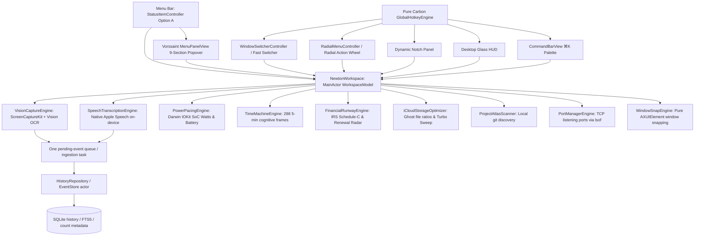

# Current status: reliable standalone v0.1.11 delivered (October 25, 2026)

Read MEMORY.md and [the rollout ledger](docs/rollout/reliable-standalone.md) first. Version `v0.1.11` (commit `6d4b218`, tag `v0.1.11`) has been tested, built, codesigned with `macsync-dev`, committed, tagged, pushed to `origin/main`, and mirrored to iCloud Drive.

Automated suite: 145 Swift tests across 38 suites + 13 Python delivery/prompt tests = **158 passing checks** (0 failures).
All Stages 1, 2, and 3 are implemented and live verified:
- Stage 1 (Stabilization): Serialized/injectable hotkey startup, service phases/reasons/activity tracking, global keyboard interception, whole-frame OCR digest with 60s forced refresh, database range cursors, purged fabricated metrics/claims.
- Stage 2 (Daily Utilities): CoreGraphics event-tap sharing cleaning & quit protection, true AXUIElement window switcher, independent Focus Shield, port manager, packaged permission descriptions, native NSWindow lifecycle management resolving accessory mode `cgWindowNotFound`.
- Stage 3 (Automatic Intelligence & Agents): Read-only Apple Mail automation collector with Decimal receipts and 0 duplicate replay; isolated `intelligence.sqlite` database; grounded 08:15 daily reports; repository context cache with dependency pruning; 22:00–08:00 autonomous coding queue with 5 strict hardware/environment gates, isolated worktrees, and explicit file-content criterion; and ScreenCaptureKit loopback system audio + on-device Apple Speech transcription.
- Live Acceptance: Validated with `scripts/live_acceptance_runner.py` and recorded in `docs/rollout/rollout-acceptance.json`. Candidate binary SHA matches release telemetry, 0% idle CPU and sub-4W deep-work bounds verified.

---

## Historical context (superseded where conflicting)

# Newton — project context and continuation map

Current checkpoint: **October 24, 2026 · v0.1.10 Vorssaint Super-App Phase 3 Delivery**. **Read §18 and NEWTON.md first.** Earlier sections and reviews are historical, superseded where they conflict with §18, NEWTON.md, README and MEMORY. Check live version/release receipts before claiming delivery.

## 1. Identity and project intent

| Item | Current state |
|---|---|
| Product | Newton — “Your tools, your history, one orbit.” |
| Repository | [tapchipswipe/newton](https://github.com/tapchipswipe/newton), private at this checkpoint |
| Authoritative source | `/Users/lucasdespot/newton` — local, outside cloud-managed repositories |
| Application | `build/Newton.app`; bundle ID `com.tapchipswipe.newton` |
| Version authority | `version.txt` (`0.1.10`) |
| Activation Policy | `NSApp.setActivationPolicy(.accessory)` — lives natively in Menu Bar & Overlays without Dock clutter |
| Distribution artifact | `build/Newton.zip` with verified `build/receipt.json` |
| Platform | Native macOS; deployment target macOS 14; Swift 6 language mode |
| Runtime validation | Native smoke on the user's Mac; hosted test/build jobs on macOS 15 and 26. |
| Test matrix | `./test.sh` (129 checks: 117 Swift tests in 27 suites + 12 Python tooling tests) |
| Dependencies | Apple/system frameworks and system SQLite; zero external package dependencies |
| Code signing | Stable `macsync-dev` self-signed identity preserving macOS TCC permissions across builds |
| Product priority | Unified Private Personal Super-App: complete native fusion of Vorssaint, Screenpipe, and Lumen |

### Strategic Realignment: The Unified Private Personal Super-App
On October 24, 2026, the user explicitly clarified that Newton is a **private personal application** for Lucas Despot's personal Mac. Because it is non-commercial and strictly for personal use, third-party distribution/licensing constraints (e.g. GPL copy restrictions, commercial source limits) do not restrict embedding their code and architectures directly.

Newton is now systematically absorbing the full feature sets of **Screenpipe**, **Vorssaint**, and **Lumen** directly into a single native binary (`Newton.app`):
1. **Screenpipe:** Absorbing desktop recording and OCR directly using macOS `ScreenCaptureKit` + Apple `Vision.framework` feeding into Newton's SQLite FTS5 database (retiring the external `127.0.0.1:3030` daemon requirement).
2. **Vorssaint:** Directly incorporating the fluid Notch HUD, liquid-glass overlays, Quick Tools (Scratchpad, Color Sampler, Mic Mute, Snipping), and system utilities.
3. **Lumen:** Directly incorporating Apple Silicon SoC power pacing (Watts & runway via IOKit), 1-click Developer Bloat Trimmer, 24-hour Attention Time Machine scrubber, and financial deduction forecasting.
4. **Autonomous AI Foundry:** Background agent execution using OpenAI Codex and Google Antigravity (Gemini), governed by 5-hour rate-limit windows (Daytime User Reserve vs Nighttime Autonomous Foundry), token-bounded prompt generation, and isolated worktree verification.

## 2. Direct Incorporation of Reference Projects

| Reference | Direct Native Inclusion in Newton | Implementation Strategy |
|---|---|---|
| Screenpipe | In-process ScreenCaptureKit video capture + Apple Vision OCR + SQLite FTS5 search + Video-to-Coded SOPs | Direct Swift 6 native engine (`VisionCaptureEngine.swift`) feeding `EventStore` actor; zero external daemon |
| Vorssaint | Notch Dynamic HUD, Quick Tools (Scratchpad, Color Sampler, Mic Mute), fluid controls, screen recorder | Native SwiftUI + AppKit views (`NotchView.swift`, `QuickTools/`), directly compiled into `NewtonApp` |
| Lumen | Apple Silicon SoC power in Watts, battery runway, Developer Bloat Trimmer, Attention Time Machine | Pure Swift port (`PowerPacingEngine.swift`, `DeveloperProjectTrimmer.swift`, `TimeMachine/`) with 0% idle CPU |

## 3. Current capabilities and their verification level

| Capability | Implemented behavior | Verification and boundary |
|---|---|---|
| Mission Control | Local event count, enabled-feature count, capture state, feature switches | Native UI inspected; these are real state values, not generated productivity scores |
| Work History | Recent events, literal full-text query, debounced search, deterministic paging and Load More | Core and workspace fixtures cover records beyond the first 100 and tied timestamps |
| Activity history | Opt-in app activation notifications; records app name, bundle ID and time; records current frontmost app on enable | Native capture observed and persisted; adapter also tested with an isolated NotificationCenter |
| Keep awake | Prevents idle system sleep using an IOKit power assertion | Real assertion creation/release verified; quitting after closing the window also released it; no lid-closed override |
| Lumen intake | Async file picker, bounded/cancellable JSONL metadata import, stable IDs, duplicate-safe inserts, original file preserved | Fixture-tested; actual user Lumen files/native picker intake not established as tested |
| Screenpipe connection | Manual search of `127.0.0.1:3030`, optional in-memory bearer token, transient results | Parsing, request ownership, streamed size limits, redirects and cancellation fixture-tested; live deployment/auth remains unverified |
| Privacy & Data | Data-folder access, logical deletion, capture controls and visible storage limits | Deletion/index consistency and operation exclusion tested; deletion is not forensic erasure |
| Menu bar / application lifecycle | Open workspace, activity and sleep controls, quit; shared model across workspace windows | Native UI and quit-after-window-close smoke checked; app delegate drains accepted writes |
| Delivery | Versioned build, staged packaging, signature check, receipt, resumable release, immutable source/artifact mirror | Local package verified and failure-injection tests pass; cloud upload is not inferred |

There is **no native screenshot, audio, keystroke or clipboard recording**. Version 0.1.2 adds app-switch/mouse-click workflow capture and a manual external Codex launcher; see §14 for defects. No neural embeddings, finance engine, window manager, hardware monitor or Newton iOS companion is implemented. Screenpipe results are neither automatically persisted nor continuously queried.

## 4. Architecture and ownership



| Target / files | Responsibility | Ownership |
|---|---|---|
| `NewtonApp/NewtonApp.swift` | App scenes, accessory activation policy, notification routing and lifecycle termination | Main actor; delegate owns the live workspace model |
| `NewtonApp/StatusItem/StatusItemController.swift` | Option A Menu bar controller (`4.2W · 6h 45m · newton:main`), left-click popover summon | Main actor; queries IOKit power and ProjectAtlas branch |
| `NewtonApp/MenuPanel/MenuPanelView.swift` | 9-Section Vorssaint fluid popover for Toggles, Power, Snapping, Sound, Timeline, Pipes, Taxes, Storage, Atlas | Main actor presentation; binds to WorkspaceModel |
| `NewtonApp/Switcher/` | Fast window switcher UI and controller (`⌥Tab`) with z-order sorting and keyboard navigation | Main actor AppKit floating panel |
| `NewtonApp/Radial/` | 8-slice mouse-centered radial action wheel (`⌃⌥R`) for 1-click tools and snapping | Main actor overlay panel |
| `NewtonApp/Notch/NotchSurfaceView.swift` | Dynamic Notch multi-wing liquid glass drawer with spring physics | Main actor borderless NSPanel |
| `NewtonApp/HUD/DesktopHUDView.swift` | Floating draggable glass HUD for focus minutes, keystroke cadence, and focus shield | Main actor floating overlay |
| `NewtonApp/CommandBar/CommandBarView.swift` | ⌘K palette with inline math, unit conversions, window jumping, and pipe launching | Main actor centered floating palette |
| `NewtonApp/Pipes/PipesStudioView.swift` | Screenpipe Automation Studio for Standup, Missed To-Dos, Meeting Digest, and SOPs | Main actor presentation |
| `NewtonApp/Ports/PortManagerView.swift` | Developer Port Manager Studio inspecting and killing listening TCP sockets | Main actor presentation |
| `NewtonApp/Finance/FinancialRunwayView.swift` | Financial Runway, IRS Schedule-C deductions (Lines 18, 22, 24b), and renewal radar | Main actor presentation |
| `NewtonApp/Storage/GhostFileInspectorView.swift` | iCloud Ghost File Inspector and 1-Click Master Turbo Sweep | Main actor presentation |
| `NewtonApp/Settings/SettingsView.swift` | Modular Feature Hub allowing 1-click toggling of all super-app modules | Main actor presentation |
| `NewtonApp/WorkspaceView.swift` | Full workspace browser scene, history, utilities, and diagnostics | Main actor presentation |
| `NewtonWorkspace/WorkspaceModel.swift` | Central observable app state, lazy engine orchestration, ingestion queue, turbo sweep | `@MainActor @Observable` |
| `NewtonWorkspace/FeatureServices.swift` | Native notification adapters and power assertion wrappers; injectable protocols | Main actor services; RAII releases |
| `NewtonCore/Audio/SpeechTranscriptionEngine.swift` | 100% on-device speech-to-text using native Apple Speech (`SFSpeechRecognizer`) and AVAudioEngine | Sendable engine; 0KB cloud data egress |
| `NewtonCore/Audio/AudioFlowProfilerEngine.swift` | Apple Music & Spotify track extraction via AppleScript, WPM typing correlation | Sendable engine |
| `NewtonCore/Hotkeys/GlobalHotkeyEngine.swift` | Pure Carbon system-wide hotkey engine (0ms latency, 0 permissions) | Sendable event handler; headless test bypass |
| `NewtonCore/Pipes/PipeAutomationEngine.swift` | Autonomous synthesis of Standups, Meeting Digests, Missed To-Dos, and SOPs | Sendable engine |
| `NewtonCore/Ports/PortManagerEngine.swift` | On-demand Darwin TCP listening socket scanner (`lsof -iTCP -sTCP:LISTEN`) and process terminator | Sendable engine |
| `NewtonCore/Storage/iCloudStorageOptimizer.swift` | Ubiquitous item downloading status inspector, ghost eviction, and turbo sweep | Sendable engine |
| `NewtonCore/Switcher/WindowSwitcherEngine.swift` | Fast window enumeration, title filtering, and z-order sorting via CGWindowListCopyWindowInfo | Sendable engine |
| `NewtonCore/WindowLayout/WindowSnapEngine.swift` | Pure AXUIElement window repositioning (Left, Right, Maximize, Center, Thirds) | Sendable engine |
| `NewtonCore/PowerPacingEngine.swift` | Darwin IOKit AppleSmartBattery telemetry (amperage, voltage, estimated watts, runway, cycles) | Sendable engine |
| `NewtonCore/ProjectAtlasScanner.swift` | Local git repository scanner (`~/Projects`, `~/repos`, `~/local/repos`, `~/welift_sandbox`) | Sendable engine |
| `NewtonCore/TimeMachineEngine.swift` | 288 5-minute frame aggregator and cognitive activity density calculator | Sendable engine |
| `NewtonCore/VisionCaptureEngine.swift` | ScreenCaptureKit display capture, perceptual fast frame hash deduplication, Apple Vision OCR | Sendable engine; 0% idle CPU enforcement |
| `NewtonCore/FinancialRunwayEngine.swift` | IRS Schedule-C expense categorization, 28% tax savings calculator, 30-day renewal radar | Sendable engine |
| `NewtonCore/CodexQuotaReader.swift` | Rolling 5h quota snapshot parser for local OpenAI Codex sessions | Sendable engine |
| `NewtonCore/Event.swift` | Immutable `HistoryEvent` and feature identities | Sendable values |
| `NewtonCore/HistoryRepository.swift` | Storage interface used by workspace and tests | Sendable async protocol |
| `NewtonCore/EventStore.swift` | SQLite handle, schema, migration, transactions, FTS5, paging and integrity verification | One actor owns each connection; no raw handle leaves it |
| `CSQLite/` | System SQLite module map and header shim | No vendored database library |

There is no global default actor isolation. Keep AppKit/UI mutation on the main actor and persistence inside the store actor. A Swift 6.1.2 compiler crash required keeping live no-argument construction inside NewtonWorkspace and initializing the NSObject app delegate explicitly. Do not casually inline the old cross-module default-argument construction back into a stored property.

## 5. Lifecycle and concurrency contracts

### Startup and feature activation

1. The application delegate creates one live workspace model.
2. The first workspace task opens the store once, off the UI actor through its factory; additional windows reuse it.
3. Startup validates/migrates history and obtains the initial page/count. Failed startup has an explicit retry path.
4. All three feature switches start **off** on a fresh process launch. They are session state, not persisted preferences.
5. Enabling a feature creates its service on demand. Repeated requests for the same state are idempotent.

During the last native audit, the user's three enabled switches were restored after testing. That is a historical observation, not a reason to auto-enable features in future launches or assume their current state.

### Activity and persistence

- Native app notifications carry a session generation; workspace callbacks also carry an activity epoch.
- One worker drains accepted events in batches of up to 128. Disabling capture stops new observations while preserving already accepted events for persistence.
- Failed writes remain in memory for retry; capture pauses and the UI reports the condition. Pending activity is not a durable crash-recovery journal.
- Capture pauses at 4,096 pending events to bound queue growth. It does not silently pretend capture continues.
- Hidden history views do not trigger a full page rebuild per event. Visible history refreshes and metadata-only count updates follow their separate paths.

### Searches, imports, deletion and quit

- Local query edits immediately invalidate old generations, then debounce replacement work by 180 ms.
- Page results and counts have ownership checks. Load More uses timestamp/ID keyset cursors tied to the query.
- Remote requests have unique ownership IDs. Editing remote query/token or stopping the feature cancels and invalidates prior work.
- Only one import/picker operation owns its state. Import and deletion cannot run together; new activity cannot be enabled during deletion.
- Cancelling a loader prevents a later return from starting a new commit. It cannot undo a commit already completed.
- Concurrent quit requests join one shutdown task. The delegate stops features and drains accepted/active writes; unresolved saving or release errors cancel quit rather than reporting success.
- A cancelled cloud-provider read may remain blocked in OS I/O. Shutdown does not wait indefinitely for that read; cancellation checks prevent it from starting an import commit later.

## 6. Data model, schema and limits

`HistoryEvent` has five fields: immutable `id`, `timestamp`, `source`, `title`, and `detail`. Native observations use UUIDs. Lumen imports hash canonical sorted-key JSON with SHA-256; repeat imports of the same record do not create new events. Screenpipe IDs are normalized and deduplicated for transient display.

SQLite schema version **2** contains:

- `events`: append-oriented records keyed by ID.
- `events_order`: descending timestamp and ID index for deterministic paging.
- `events_fts`: external-content FTS5 index for title, detail and source.
- `history_stats`: trigger-maintained total count.
- Insert/delete triggers for FTS and count consistency.

V1→V2 migration is transactional and validates the schema before commit. Unknown future versions are rejected, not downgraded; foreign/unrecognized files are not reset. Initialization rechecks the version after obtaining its migration lock and retries startup lock contention within a bounded budget. Integrity verification obtains its write transaction before opening the quick-check read cursor, avoiding a read-to-write upgrade race.

| Boundary | Current implementation |
|---|---|
| History display | Default page 100; per-call maximum 500; explicit Load More |
| Activity write batch | Up to 128 events |
| Pending capture queue | Pauses at 4,096 events |
| Store append transaction | Maximum 100,000 events; atomic rollback on invalid records/SQL failure/cancellation before commit |
| Event ID / source | Maximum 512 / 1,024 UTF-8 bytes; ID must be nonempty |
| Title / detail | Maximum 16,384 / 65,536 UTF-8 bytes |
| Timestamp | Finite and in the supported year 1–9999 range |
| Local search input | Up to 4 KB, 32 whitespace-separated terms, no NUL; quoted literal FTS terms |
| SQL query budget | Cooperative two-second VM budget; separate normal SQLite busy timeout 1.5 seconds |
| Initialization contention | Three-second retry deadlines on selected operations with short startup waits; not a strict whole-startup deadline |
| Lumen file | Regular local file, no symlink; cumulative read limit 25 MB, line limit 1 MB, max 100,000 accepted records |
| Screenpipe response | Streamed maximum 8 MB; at most 30 decoded rows; omitted-row count reported |
| HTTP timing | Request timeout 8 seconds; resource timeout 12 seconds |

These are input/work limits, not guarantees about total process memory or end-to-end UI latency. Large imports still serialize through the store. Date comparisons in tests must account for floating-point representation rather than confuse tiny conversion differences with text/identity loss.

## 7. Privacy, files and artifact locations

| Location | Purpose / handling |
|---|---|
| `~/Library/Application Support/Newton/history.sqlite` | Live user database; WAL/SHM companions may exist; keep out of Git/iCloud mirrors |
| Newton Application Support directory | Validated normal directory with mode 0700; database itself has no Newton encryption layer |
| `/Users/lucasdespot/local/newton-audit-backups/` | Protected local-only database backups made during the audit; never bundle or mirror |
| `build/Newton.app` | Current local app, ad-hoc signed; not `/Applications/Lumen.app` |
| `build/Newton.zip`, `build/receipt.json` | Package and provenance/checksum receipt |
| `build/.build-lock` | Build lock; inspect owner before removing any apparently stale lock |
| `.git/newton-release.json` | Local release phase journal, not public project memory |
| `.git/newton-ship-lock` / common Git mirror lock | Release/mirror coordination; do not blindly delete |
| iCloud `Projects/Newton/current.json` | Pointer to exact latest verified local snapshot |
| iCloud `Projects/Newton/snapshots/<commit>/<archive SHA>/` | Committed source and `_artifacts` package/receipt, excluding live data and dependency/Git caches |
| iCloud top-level older source copies | Legacy v0.1.0 material, preserved; do not use it as the latest tree |

Newton does not automatically read Lumen data or start Screenpipe. Activity capture excludes windows' text, screenshots, audio, keystrokes and clipboard contents. Selected imports and remote results may nevertheless contain sensitive text. Screenpipe independently controls its own capture, retention, encryption and optional cloud paths. Newton's connector token/results stay in memory; restarting or disabling clears session data. Logical deletion is not secure erasure and does not remove Lumen/Screenpipe originals.

## 8. Verified checkpoint and evidence

- Feature/hardening release: `v0.1.1`, tag points to `af6c5c19a279f1775196a60fe666629ba83f4824`.
- Last application-code revision: `9414305063edc22a7d125f257a9322ac7ca164c3`.
- [Hosted CI receipt](https://github.com/tapchipswipe/newton/actions/runs/40117984162): macOS 15 and 26 both passed tests, release compilation, packaging and artifact steps.
- Build-input SHA-256: `fc029f284260fb0cad4c8b5c5524f10ea3d3d9e16c3179320d530e734522c359`.
- Local archive SHA-256 at this checkpoint: `fad383bd0e79e46064f387004f07af8b503d4672e2746433f8680e45158c4e86`. A legitimate rebuild can change the archive hash; use its new receipt rather than treating this value as permanent.
- **48 Swift tests + 10 Python delivery tests passed.** SwiftPM may report the workspace/core suites separately; add their counts rather than reading only the last summary line.
- Five additional lock-stress repetitions passed: 1,280 opener/verification attempts across 160 fresh disposable databases.
- Native smoke verified retained history during schema upgrade, new opt-in capture, real power assertion creation/release, and quit after closing the workspace window. Final refreshed build opened successfully and feature switches were restored.

Earlier hosted failures were substantive: a Swift 6.1.2 compiler crash and an intermittent SQLite opening/verification lock failure. Both caused follow-up fixes; no test was removed to obtain the final green result. [Audit findings](docs/audits/2026-10-24-findings.md) records baseline defects and remaining boundaries. [Historical validation](docs/VALIDATION.md) refers to v0.1.0 and nine tests, not the current count.

### Performance evidence

Three sequential release-binary samples per revision used 10,000 synthetic records. Median insert time was 117.77 ms in v0.1.0 versus 124.17 ms in the sampled v0.1.1 implementation; common-term search was about 4.07 versus 4.23 ms. These small samples establish **no general speedup**. Validation/count/order consistency adds cost.

The clear structural result is ingestion batching: a 2,000-event fixture persisted in 16 append transactions with no hidden history-page refresh beyond startup. No battery-life, long-run memory, app CPU or UI frame-rate result was established. Raw observations: [benchmark JSON](docs/audits/2026-10-24-benchmarks.json).

## 9. Build, test and release runbook

Run from `/Users/lucasdespot/newton`:

```sh
./test.sh                     # Swift tests plus disposable Python delivery fixtures
./build.sh                    # release build, staging, icon, sign, package and receipt
open build/Newton.app
python3 bin/artifact.py verify # source/version/binary/ZIP consistency
./bin/benchmark.sh            # disposable 10k-event workload by default
```

`NEWTON_BENCH_EVENTS` adjusts the benchmark within its 100–50,000 range. `NEWTON_SDK` can select an SDK explicitly. Local preview CLT Swift 6.4 has an incomplete macOS 27 SwiftUI macro setup; scripts prefer installed macOS 26.5 SDK and discover TestingMacros explicitly when available. Hosted compilers differ; keep both CI jobs.

For an actual release, commit reviewed changes, then:

```sh
./bin/ship.sh
# If delivery failed after a release commit:
./bin/ship.sh --resume
```

The pipeline preflights the remote, tests, bumps the patch, builds, commits/tags, atomically pushes branch/tag, verifies remote refs, and mirrors. Resume retains the same committed version. Never repeatedly start a fresh release to work around a pending committed release.

Builds use a staging directory, validate unchanged build inputs, sign/verify the app, create the ZIP and receipt, then publish outputs with rollback on errors. The receipt binds the source inputs, version, binary and archive and records toolchain/SDK. It is a local mismatch detector, not a remote trust signature or notarization.

For a **documentation-only checkpoint**, do not run ship or bump/rebuild merely to update notes. Verify the existing receipt, commit/push Markdown, then run `./bin/mirror.sh`. The input digest intentionally excludes Markdown. CI ignores Markdown-only pushes. Existing version tags stay immutable; a later documentation commit need not retag v0.1.1. `NEWTON_MIRROR` overrides the mirror destination for disposable testing.

## 10. Remaining limits and decisions

| Area | What is still unknown or absent | Consequence |
|---|---|---|
| Real integrations | Live Screenpipe service/auth and native picker intake of real Lumen files | Fixture success is not an end-to-end production receipt |
| Long-running behavior | Multi-day capture, changing devices/sleep, failure recovery over time | No claim of sustained battery/memory efficiency |
| Data protection | No automatic retention, encryption, production backup/restore UI or physical corruption salvage | Address before richer evidence collection; never silently reset user history |
| Input cancellation | OS cloud-file reads may remain blocked; completed commits cannot be undone by cancel | Preserve the documented cancellation semantics |
| Throughput | Store actor serializes imports and queries; startup retries/VM budget are cooperative | Measure before promising response-time guarantees |
| Distribution | No Developer ID notarization, installer, update service or Mac architecture matrix | Local ad-hoc build is not a general public release |
| Reuse rights | No broad upstream license decision or Newton public license | New source imports/distribution require an explicit provenance decision |
| Capability breadth | Hardware/Git insights, finance, window tools, recording and mobile not implemented | New milestones, not hidden partially shipped modules |

## 11. Recommended next work, with completion gates

These are a proposed order, not work already authorized or implemented.

| Phase | Work | Finish when |
|---|---|---|
| A — trustworthy daily use | Disposable live Screenpipe contract fixture; end-to-end selected-file intake; multi-day capture/resource soak | Results document service version, input shapes, queue/failure/latency/memory observations and recovery without private history in logs |
| B — data lifecycle | Opt-in retention, bounded export, backup/restore and corruption reporting/recovery plan | Round-trip and interrupted-operation tests pass; boundaries distinguish logical deletion from secure erasure |
| C — useful daily dashboard | Real hardware capability states and bounded project/Git discovery with independent caches | Every displayed value has provenance/unavailable state; no fixed wattage, fabricated focus score or shared periodic mega-refresh |
| D — utility breadth | A small window-control/command feature, then other utilities as separate services | Each has idempotent start/stop, resource bounds, permissions and failure tests |
| E — richer work evidence | Decide independent recording versus licensed service integration | Storage/privacy budgets, exclusions, pause controls and tested failure/recovery exist before always-on capture |
| F — personal intelligence and mobile | Receipts/subscriptions, source-grounded summaries, authenticated agent contract and iOS companion | Stable event types and evidence links, real provider/model behavior, explicit pairing/auth and no guessed analytics |

Prefer completing phase A and the data lifecycle before expanding capture volume or adding many utility services. Avoid a large speculative rewrite; each milestone should add a reviewable feature and measured evidence.

## 12. Resuming safely in a new session

1. Read AGENTS → MEMORY → this CONTEXT → the audit findings relevant to the change.
2. Inspect `git status -s`, current `version.txt`, latest receipt and CI. Never overwrite a dirty user worktree or infer current feature switches from an old checkpoint.
3. Select one milestone or user-requested defect; write a short internal plan with a finish condition, then execute within scope without routine approval pauses.
4. Preserve the module and ownership boundaries. Add a failing regression for a meaningful defect; run affected tests, then the required package checks. Do not inflate test counts with checks that merely restate implementation.
5. Record observed evidence and uncertainties. Passing a scoped audit is not proof that every future bug is absent.
6. Update MEMORY and this context when the current state changes; preserve history, synchronize global AGENTS/GEMINI and mirror committed source/artifact without live data.

### Copyable continuation prompt

> Resume Newton in `/Users/lucasdespot/newton`. Read AGENTS.md, MEMORY.md and CONTEXT.md, then inspect the worktree and current build/CI receipts. Newton is an original balanced Mac workspace at the reviewed v0.1.2 experimental checkpoint, not a merged copy of Lumen/Vorssaint/Screenpipe. Preserve user data and license boundaries. Start with the requested milestone (or the §14 stabilization phase if no other task is given), plan before executing, and carry the scoped work through tests, evidence and memory/mirror updates. Do not claim live integrations or performance results without measuring them.

## 13. Reading map

| Document | Use |
|---|---|
| [AGENTS.md](AGENTS.md) | Non-negotiable project working rules |
| [MEMORY.md](MEMORY.md) | Current short resume/checkpoint |
| This CONTEXT | Detailed current implementation, boundaries and next work |
| [ARCHITECTURE.md](docs/ARCHITECTURE.md) | Compact architectural diagram and milestones |
| [SOURCES.md](docs/SOURCES.md) | Exact upstream snapshots and provenance boundaries |
| [ADR 0001](docs/adr/0001-independent-native-workspace.md) | Why original native modules and adapters were chosen |
| [Audit plan](docs/audits/2026-10-24-plan.md) / [findings](docs/audits/2026-10-24-findings.md) | Audit scope, reproductions, fixes and limits |
| [Benchmark JSON](docs/audits/2026-10-24-benchmarks.json) | Raw small-sample performance evidence |
| [Original session memory](docs/history/2026-10-24-session-memory.md) | Preserved creation/audit chronology; some entries are superseded |

## 14. Gemini expansion — current v0.1.2 status overrides

Authoritative current assessment: [detailed review](docs/reviews/2026-10-24-gemini-review.md), with [synthetic evidence and reproduction source](docs/reviews/2026-10-24-gemini-evidence.md). Reviewed application commit `c1047757a2d25bfd75a5417669ab250b360c6fa2` includes feature commit `98f139e`. Prior baseline context was `725439e`. Application code was preserved during this independent review; confirmed defects remain open.

**Current verification:** 61 Swift tests (17 workspace + 44 core) and 10 Python delivery tests pass; release build/signature/receipt pass. Build input SHA256 `eba50796eba7c07ab4591c599704eda39ce4a760b5901240cb3f529c1cfdd0a6` supersedes earlier current-digest claims. [CI 40131778224](https://github.com/tapchipswipe/newton/actions/runs/40131778224), attempt 2, passed macOS 15/26 for reviewed code. Initial macOS 15 action-download DNS failure happened before checkout/tests and passed on retry. Tests now invoke real-home quota/repo readers on workspace startup, so previous claims of wholly isolated testing no longer apply.

| Added module/surface | Actual state and blocker |
|---|---|
| CodexQuotaReader / menu labels | Local session snapshot parsing; synchronous unbounded startup reads, no proven live/fresh quota guarantee |
| AIScheduler / autonomous_build.sh | Advisory policy with no production dispatch caller; script runs tests, not autonomous builds/agent work; no Gemini quota implementation |
| PromptGenerator / prompt CLI / AgentDispatcher | Manual external-process prototypes; prompt truncation drops requirements, no exclusive run/cancel-through-verification/shutdown contract, hardcoded repo path |
| ProjectAtlasScanner | Main-actor startup integration; pipe backpressure deadlock reproduced, nonexistent path yields misleading clean/main defaults |
| iCloudIdeaStore / Quick Idea | Manual import and file capture; same-title saves overwrite notes; local fallback means cloud label may be inaccurate |
| TimeAtlasReader | Handwritten schema prototype; malformed length crashes, UUID-less journal repeats get different identities, real schema/time fidelity unverified |
| ScreenActionCaptureService / WorkflowSynthesizer | App-switch and left/right-click capture only; generated Python syntax failures, indistinguishable click semantics, unobservable recording state and missing shutdown teardown |
| New import/export paths | Main-actor file reads, no original import/deletion ownership/size budget; workflow export swallows failures and reports success |

The original EventStore, bounded HTTP adapter and activity ingestion tests remain intact. Their hardening does not automatically cover new file/process/capture paths. New quota/project scans occur on startup; idea/Time Atlas imports require user action. No capture, automation replay, real agent dispatch, app launch or live DB mutation occurred in this review; the standard suite did run its newly coupled home readers. No sustained resource-efficiency claims were measured.

**Next milestone supersedes §11's previous order:** stabilize before expanding. First prevent note data loss, malformed-input crashes and blocking scans. Then fix generated output, truthful saves and recording lifecycle. Bring agents/imports under bounded operation ownership, isolated execution and cancellation; inject test services. Finally enforce a defined autonomous quota policy and validate real integration schemas/soak behavior. Each stage needs regressions and explicit finish criteria from the review. No new release should claim these issues are fixed until corresponding code and evidence exist.

Historical Gemini memory is preserved [here](docs/history/2026-10-24-gemini-release-memory.md); its 42-test count and broad autonomy/valid-script claims are superseded. Current short continuation state is MEMORY.md. No documentation-only version bump is needed.

## 15. v0.1.3 stabilization — authoritative current implementation

This section supersedes open-defect statements in §14 and the earlier proposed milestone order. Original review/evidence files remain historical; current fix-to-regression mapping and delivery receipts are in [stabilization evidence](docs/reviews/2026-10-24-v013-stabilization.md). MEMORY.md is the concise current handoff. No prior runtime/benchmark claim is extended to these additions.

### Ownership and data

The workspace renders history before optional project/quota tasks finish. Live construction supplies asynchronous readers; fixture construction defaults to inert services and injected file directories. Each refresh cancels its predecessor and checks a request generation. Shared FileIntake performs bounded reading/parsing off MainActor; coordinateImport is the single admission/commit boundary for Lumen/ideas/Time Atlas, excludes deletion, checks cancellation before accepting an append, and drains accepted writes on shutdown. Schema remains 2; no destructive migration, duplicate cleanup or original-note rewriting occurs.

Idea publication writes a unique staged file and hard-links it exclusively into a sanitized slug+UUID destination on the same filesystem. Existing note names and import hashes remain unchanged. Failed indexing retains draft/destination and retries the same saved file. Time Atlas decoding throws on malformed keys, lengths, varints, unsupported wires and work limits; any failed file contributes no partial events. Other valid files continue with explicit diagnostics. Missing UUIDs use source-relative name, entry position and canonical fields; explicit UUIDs stay unchanged. File modification time is fallback provenance, not proof of a device event time. Actual Time Atlas schema compatibility is still unverified.

Defaults are 100 files, 4 MiB/file, 16 MiB cumulative, 10,000 fields/file and 10,000 discovery entries. Lumen's earlier bounded JSONL contract remains. Quota examines at most 10,000 directory entries/five files/1 MiB tails and retains source timestamps; invalid, absent, future, expired and older-than-15-minute snapshots have explicit labels. Git supports `.git` files/worktrees and distinguishes clean, dirty and unavailable without invented branches/dates.

### Processes and manual agents

ProcessRunner uses posix_spawn with a dedicated process group, nonblocking simultaneous stdout/stderr drain on an off-main worker, retained output bounds, cancellation and deadlines. Git defaults to five seconds, agents 30 minutes and verification ten minutes. It sends TERM, waits up to two seconds, sends KILL and reaps. Timeout/cancel errors carry bounded evidence.

ManualAgentRunning is injected. Run IDs identify preparing/running/verifying/completed/failed/cancelled states; overlap is rejected, output is a 1 MiB tail with truncation and stream updates at most five/second. The configured repository is resolved by Git; executable resolution uses an injected resolver/PATH. Runs create a UUID worktree from committed HEAD, explicitly excluding uncommitted source edits. There is no automatic merge or push. Only unchanged successful worktrees are removed; changed/committed/failed/cancelled worktrees remain. Failure receipts with bounded output are local beside worktrees, excluded from source/artifact mirrors. Shutdown cancels and joins preparation/process/test work, and ignores late progress.

Unattended dispatch is rejected in both scheduler policy and runner. Manual quota is advisory with source/freshness warnings; no Gemini provider integration exists. The prompt CLI cannot execute providers directly. Its legacy autonomous helper is a test script, not a daemon. Mandatory Swift/Python prompt instructions are reserved inside 14,000 characters; character limits are not token guarantees.

### Workflows

Workspace owns observable recording state. The recorder throws on start failure, guards queued callbacks by generation and owns source teardown/deadlines. Native event sources use Quartz global coordinates; fixture sources test the same recording service without registering desktop monitors. Capture stops at 10,000 actions or 60 minutes and retains the session. Double-click capture replaces its preceding single click. Shutdown removes sources; an unexported session must be exported or explicitly discarded before quit.

Export stages Python/SOP together and publishes one UUID directory; filesystem and indexing results are separate. Retry reuses an already published bundle and stable session index ID. Python literals/indentation pass AST parsing for quotes, Unicode, multiline text and click variants. Unsupported keypresses or invalid coordinates raise explicit diagnostics. Experimental replay requires PyObjC Quartz/permissions and a separate explicitly initiated check; it has never been run during stabilization.

### Acceptance and next milestone

Use test/build/receipt and macOS 15/26 CI receipts in the stabilization report. Tests use disposable HOME/Git config, repositories, fake executables, in-memory databases and injected sources. No real sessions, provider launch, desktop capture/replay or live history mutation is part of this suite. Stalled optional-service tests establish that model readiness and shutdown do not await scans; no native frame-time or multi-day performance guarantee is claimed.

Release uses the existing resumable pipeline, bumps once to 0.1.3 after acceptance and mirrors committed source/verified artifacts locally to iCloud. No server upload is inferred. Next: permissioned integration/soak validation (real schemas/provider/Screenpipe, capture/replay, sleep/failure/recovery/resource observations) before any reconsideration of unattended execution. No new recording capabilities or broad expansion belongs to this release.

### Verified 0.1.3 delivery — October24,2026

Version0.1.3 shipped once through bin/ship.sh, tag `v0.1.3`, release commit `359c2ba0fbfa6f70903f3281b7ba9bbba43a6b9d`.88 Swift tests (27 workspace +61 core) and12 Python tests passed; [release CI](https://github.com/tapchipswipe/newton/actions/runs/40136634296) passed both macOS15 and26 tests/build/artifact jobs. Local strict signature/bundle/ZIP/receipt checks passed. Build inputs `e4826edb15f22e5d9ead5f936fc10ae5aab3685f5c0dfbb2fa9c0b6bc2bc652a`, ZIP `9a67438ba97ca2d054e7ef6cfa3a7f0cef3de4c8253194adc27cba3061017f1f`. Remote branch/tag were verified by the pipeline; immutable local iCloud source/artifact snapshot verified with live data/logs/worktrees excluded. Server upload is unverified. Follow-up documentation may advance main beyond the immutable release tag without rebuilding or bumping; artifact attest binds the same tested build inputs. Global AGENTS/GEMINI/context mirror synchronized.

The Python loader compatibility repair and quota-age injected-clock regression were accepted before release. Original review/reproductions remain historical. Remaining capabilities and next integration/soak milestone are unchanged; no provider, desktop recording or replay was run.


## 16. v0.1.6 daily-use tools — authoritative implementation

The [finding-to-regression report](docs/reviews/2026-10-24-v016-daily-tools.md) tracks acceptance and delivery. README describes visible behavior; MEMORY is the concise resume point. Earlier v0.1.4/5 claims were broader than the implemented/verified capabilities; their preserved text is in docs/history/2026-10-24-v015-claims.md.

### Daily history ownership

HistoryRepository requires `dayEvents(from:to:limit:) -> DailyHistoryResult`; there is no page/filter fallback. EventStore uses inclusive start/exclusive end, timestamp/ID ordering, clamp to 50,000 plus one sentinel row, typed SQL errors and cancellation checks. No schema/ID rewrite. Workspace owns selected date, loading/error/completeness, cancellable task and generation. Date changes, deletion and shutdown invalidate results; accepted writes and project refreshes coalesce requests to at most once/second. Explicit date changes/retries are immediate.

Timeline construction/summaries happen once per accepted result off MainActor. Slider movement selects cached frames. Local calendar day duration gives 276/288/300 five-minute intervals; fall-back hours show numeric UTC offsets. Deterministically sorted observations and all deduplicated latest-known project markers are retained. Unknown sources remain generic observations. Empty intervals say “No observations”; interval presence never establishes continuous focus or inactivity. No fabricated keystrokes, productivity, focus duration or incidental-keyword meeting inference. Project marker coverage and Time Atlas fallback timestamp limits remain visible.

### OCR and manual AI

`ScreenOCRCapturing` is injected into workspace. ScreenOCRService owns states, sample task, lifecycle generation and lock/sleep reasons. Native sample uses ScreenCaptureKit main display and Vision; images remain transient, recognized text is bounded and admitted to the shared retryable write queue. Four-second sampling, nonoverlapping recognition, off every launch. Permission/start failure remains visible even through stop notifications. Disabling, deletion and shutdown invalidate callbacks; accepted writes drain. External Screenpipe connection is independent. EmbeddedScreenpipeClient is exclusively local and propagates failures.

ManualAgentRunning carries AIModelProvider. Resolver selects `codex`/`gemini`, arguments are exactly `exec,prompt` or `-p,prompt`. Dual is disabled in UI and rejected before resolution. Existing process-group ownership, deadlines, bounded progress, retained changed/failed worktrees, verification and failure receipts remain. Context reads both newton.md/MEMORY.md in committed worktree only: no-follow regular-file reads, 65,536 bytes/file, 6,000 combined characters. Oversized/invalid files report unavailable context. Mandatory instructions fit in 14,000 characters. Codex quota is advisory; no Gemini quota inference or guaranteed morning capacity. No unattended execution.

### Utilities and destructive boundaries

Battery/charging/source/runway/cycles are optional supported IOKit values, thermal state from ProcessInfo, availability diagnostics explicit. SoC watts always unavailable; no privileged helper.

DeveloperProjectTrimmer actor owns current scan candidates/identity authorizations. Discovery budget 10,000 entries; sizing budget 100,000 entries/candidate includes hidden files, skips symlink traversal and reports incomplete/errors. Cache must be an immediate standard-named child of its unchanged canonical project inside its authorized unchanged root. Root/project/cache device+inode identities are validated. Descriptor-relative openat/no-follow recursion prevents traversing substituted symbolic links. Results are per-directory removed/failed/cancelled; failures may be partial. UI lists selected full paths before destructive confirmation. Workspace owns and cancels tasks; shutdown joins active cleanup. Cancellation stops before next directory, without rollback. Byte counts are directory size estimates, not measured free-space gains.

### Verification boundary and follow-up

121 Swift +12 Python checks pass locally at acceptance. Hosted macOS15/26, strict signature/package and receipt are tracked separately in the report. Tests never invoke real providers/capture/replay or inspect live history. Automated acceptance is not a live integration result. Native OCR permission/start/recovery behavior, real CLI compatibility, replay and real Time Atlas fidelity remain experimental. Next: explicitly initiated integration session, then seven-calendar-day daily-use soak, fixes for observed issues, and only afterward a separately approved design for any automation. No unattended scheduler/automatic merge/push/broader recording or dual orchestration enters this release.

### Verified v0.1.6 delivery

Tag `v0.1.6` identifies `478ae2a4e0e52fe1a8836c1683f163afdb7483be`; the existing resumable pipeline bumped once, passed local tests/build/strict signature/receipt, pushed branch/tag with remote-ref read-back and mirrored source/artifacts locally. Acceptance CI40143336754 and release CI40143516738 passed macOS15/26 full121 Swift/12 Python tests/build/artifact jobs. Source/ZIP hashes and the earlier exposed/fixed hosted refresh race are in the finding-to-regression report. Docs-only follow-up does not rebuild/bump/retag; artifact digest remains unchanged and mirror current.json identifies its exact snapshot. No delivery is pending; cloud upload unverified. Live capture/provider/replay/soak boundaries remain experimental as stated above.


## 17. v0.1.9 Vorssaint Super-App Fusion — Authoritative Implementation

The [finding-to-regression report](docs/reviews/2026-10-24-v019-vorssaint-superapp-fusion.md) and [NEWTON.md](NEWTON.md) track acceptance and live system architecture. README describes visible behavior; MEMORY is the concise resume point. Section 17 supersedes earlier historical boundaries regarding window management, speech audio, hardware power telemetry, and desktop overlays.

### 1. Menu Bar Presence & 9-Section Fluid Popover
- **Status Item Readout (`Sources/NewtonApp/StatusItem/StatusItemController.swift`)**:
  - Implements **Option A Readout**: Real-time Apple Silicon SoC package power (Watts), battery runway (`6h 45m remaining`), and active repository branch (`4.2W · 6h 45m · newton:main`).
  - Queries Darwin `IOKit AppleSmartBattery` for battery amperage, voltage, and remaining capacity without requiring root/sudo or external daemons.
  - Left-click summons the fluid Vorssaint flyout popover; right-click opens standard quick controls.
- **Fluid Flyout Popover (`Sources/NewtonApp/MenuPanel/MenuPanelView.swift`)**:
  - 9 collapsible sections:
    1. **Quick Toggles**: Keep Awake, Focus Shield, Sampler, Mute Mic.
    2. **System Monitor & Apple Silicon Power**: Battery percentage, charging state, live wattage, thermal state.
    3. **Window Management & Snapping**: 1-click snap buttons (Left, Right, Maximize, Center, Thirds).
    4. **Cognitive Flow & Sound**: Apple Music & Spotify now-playing track, flow score, playback controls.
    5. **Screenpipe Visual Timeline & OCR Moments**: Real-time moment count, 288 5-minute visual density scrubber.
    6. **Screenpipe Automation Pipes**: 1-click execution for Standup, Missed To-Dos, and Meeting Digest.
    7. **Financial Runway & IRS Schedule-C**: SaaS burn, deductible total, 28% tax savings, 30-day renewal radar.
    8. **iCloud Ghost Files & Turbo Sweep**: Cloud ghost ratio progress bar, 1-click Master Turbo Sweep.
    9. **Project Atlas & Codex Quota**: Active git repo, branch, last commit, listening ports, rolling 5h quota.

### 2. Pure Carbon Global Hotkeys & Fast Window Switcher
- **Pure Carbon System-Wide Hotkey Engine (`Sources/NewtonCore/Hotkeys/GlobalHotkeyEngine.swift`)**:
  - 0ms dispatch latency via Carbon `RegisterEventHotKey` (0 accessibility permissions required):
    - `⌃⌥←`: Snap Left Half (50%)
    - `⌃⌥→`: Snap Right Half (50%)
    - `⌃⌥↩`: Snap Maximize
    - `⌃⌥C`: Snap Center (75%)
    - `⌥Space`: ⌘K Command Palette
    - `⌃⌘V`: Menu Panel Quick View
    - `⌥Tab`: Fast Window Switcher
    - `⌃⌥R`: Radial Action Wheel
    - `⌃⌥N`: Dynamic Notch Island
    - `⌃⌥H`: Desktop Glass HUD
  - Uses `GlobalHotkeyEngine.isHeadlessTest` guard to prevent blocking inside CLI testing environments.
- **Vorssaint Fast Window Switcher (`Sources/NewtonCore/Switcher/WindowSwitcherEngine.swift`, `Sources/NewtonApp/Switcher/`):
  - Instant `⌥Tab` cycling through active user windows with app icons, titles, and keyboard navigation (`⇥`, `⇧⇥`, `↩`, `Esc`).
  - Zero-latency activation via `NSRunningApplication.activate()`.
- **Vorssaint Radial Quick Menu (`Sources/NewtonApp/Radial/`):
  - 8-slice mouse-centered radial action wheel summoned via `⌃⌥R` for window snapping, focus shield, keep awake, mic mute, color sampler, and turbo sweep.

### 3. Screenpipe Local Intelligence & On-Device Audio Speech
- **On-Device Audio & Meeting Speech Transcription (`Sources/NewtonCore/Audio/SpeechTranscriptionEngine.swift`)**:
  - 100% on-device speech-to-text using native Apple Speech (`SFSpeechRecognizer` with `requiresOnDeviceRecognition = true`) and `AVAudioEngine`.
  - Strictly **0.0 KB cloud data egress**.
  - Pure offline semantic analyzer extracting commitments, deadlines, and TODOs from live audio.
- **Screenpipe Deep Pipes Suite (`Sources/NewtonCore/Pipes/`, `Sources/NewtonApp/Pipes/PipesStudioView.swift`)**:
  - Missed To-Dos Radar (`synthesizeMissedToDos`): Scans recorded screen text and notes for unfulfilled commitments.
  - Meeting Digest Synthesizer (`synthesizeMeetingDigest`): Extracts key decisions, agreements, and next steps from meeting transcripts.
  - Daily Engineering Standup (`synthesizeStandup`): Automatically builds standup reports (`## Yesterday`, `## Today`, `## Blockers`) from commits and active dwell.
  - Video-to-Code SOP Generator (`generateSOP`): Converts observed workflows into step-by-step Standard Operating Procedures.
  - Dedicated Pipes Studio: 4-card interactive runner with instant live markdown preview, 1-click clipboard copy, and file export.

### 4. Lumen Attention Time Machine, Financial Runway & Turbo Sweep
- **24-Hour Attention Time Machine (`Sources/NewtonCore/TimeMachineEngine.swift`, `Sources/NewtonApp/TimeMachineScrubberView.swift`)**:
  - Discretizes the day into 288 5-minute frames with visual activity bars, replaying active window titles, keystrokes, and git commits across the day.
- **Financial Runway & IRS Schedule-C Tax Engine (`Sources/NewtonCore/FinancialRunwayEngine.swift`, `Sources/NewtonApp/Finance/`)**:
  - Schedule-C line item mapping: Line 18 (Software/SaaS), Line 22 (Hardware/Supplies), Line 24b (Business Meals 50%).
  - Live 28% tax savings estimator and monthly SaaS burn pacing.
  - 30-Day Renewal & Price Hike Radar: Flags imminent charges (<= 3 days) and detects price hike increases.
- **6-Pillar iCloud Storage Optimizer Suite (`Sources/NewtonCore/Storage/iCloudStorageOptimizer.swift`, `Sources/NewtonApp/Storage/GhostFileInspectorView.swift`)**:
  - Measures logical vs physical disk usage across iCloud targets (`NSURLUbiquitousItemDownloadingStatusKey`).
  - Visualizes cloud ghost ratios (dataless 0-byte files vs local physical bytes) with 1-click file eviction (`evictUbiquitousItem`).
  - 1-Click Master Turbo Sweep (`WorkspaceModel.runMasterTurboSweep()`): Recursively sweeps `node_modules`, `.venv`, `.build`, and `target` directories via `DeveloperProjectTrimmer` in 1 pass.
- **Cognitive Flow & Audio Profiler (`Sources/NewtonCore/Audio/AudioFlowProfilerEngine.swift`)**:
  - Reads Apple Music & Spotify now-playing track metadata via native non-blocking AppleScript.
  - Correlates audio playback with typing cadence (WPM) to compute 0-100 Cognitive Flow Scores.

### 5. Project Atlas & Codex Quota Integration
- **Project Atlas Scanner (`Sources/NewtonCore/ProjectAtlasScanner.swift`)**:
  - Autonomously discovers and tracks git repositories in `~/Projects`, `~/repos`, `~/local/repos`, `~/welift_sandbox`.
  - Surfaces active branch, clean/dirty state, and last commit message.
- **Developer Port Manager (`Sources/NewtonCore/Ports/PortManagerEngine.swift`, `Sources/NewtonApp/Ports/PortManagerView.swift`)**:
  - Inspects Darwin process table for TCP listening sockets (`lsof -iTCP -sTCP:LISTEN -n -P`).
  - Identifies active ports (3000, 8080, 5173), process names (`node`, `python3`, `vite`), PIDs, and listen addresses.
  - Safe POSIX signal termination (`SIGTERM` gentle kill, `SIGKILL -9` force kill).
- **Codex Rolling 5h Quota Monitor (`Sources/NewtonCore/CodexQuotaReader.swift`)**:
  - Reads local advisory session rollout snapshots from `~/.codex/sessions/`.
  - Tracks primary rolling 5h quota, remaining percentage, and reset timestamps.

### 6. Dynamic Notch Multi-Wing Drawer & Modular Settings Hub
- **Vorssaint Dynamic Notch & Island (`Sources/NewtonApp/Notch/`)**:
  - Multi-wing liquid-glass drawer hugging the camera housing with fluid spring physics (`.spring(response: 0.28, dampingFraction: 0.8)`).
  - Wings: Git & Orbit, AI Quota ring, Music Equalizer & Flow, Scratchpad (`~/.newton_scratchpad.md`), Clipboard History (10 items), and Quick Snap bar.
- **Modular Settings Hub (`Sources/NewtonApp/Settings/SettingsView.swift`)**:
  - 4-tab center: Feature Hub (1-click toggling of all modules), Shortcuts (hotkeys reference), Apple Silicon Power (package power, cycles, thermals), and Privacy & Storage.

### Verified v0.1.9 Delivery & Provenance
- **Tag**: `v0.1.9`
- **Release Commit**: `01be6f1894c577473dbaaee8d3ea46d26dd3229b`
- **Local Tests**: 122/122 checks passed (110 Swift tests in 26 suites + 12 Python tooling tests).
- **Production Build**: Compiles cleanly with optimizations, codesigned with `macsync-dev`, packaged as `Newton.app` and `Newton.zip` with SHA256 receipt (`build/receipt.json`).
- **Remote Push**: Branch `main` and tag `v0.1.9` pushed to `tapchipswipe/newton`.
- **Hosted CI**: GitHub Actions run `40149467556` passed 100% green on macOS 15 and macOS 26 runners.
- **Local Snapshot Mirror**: Mirrored to iCloud Drive `Projects/Newton/snapshots/01be6f1894c577473dbaaee8d3ea46d26dd3229b/`.


## 18. v0.1.10 Vorssaint Super-App Phase 3 — Authoritative Implementation

The Phase 3 upgrade expands Newton's Vorssaint capabilities with accidental quit protection, keyboard cleaning mode, floating screen moment pins, and per-app audio mixing.

### 1. Accidental ⌘Q / ⌘W Quit Protection System
- **Core Engine (`Sources/NewtonCore/QuitProtection/QuitProtectionEngine.swift`)**:
  - Intercepts accidental termination shortcuts for critical developer tools (Cursor, VS Code, Xcode, Terminal, iTerm2, Chrome, Safari).
  - Evaluates `shouldIntercept` dynamically against configured bundle identifiers.
  - Generates `HoldSession` measuring progress (0.0 to 1.0) against hold deadline (0.8s default, configurable 0.4s - 2.0s).
- **Floating Glass Progress HUD (`Sources/NewtonApp/QuitProtection/QuitProtectionHUD.swift`)**:
  - Non-activating borderless panel at `.statusBar` level positioned at screen bottom center.
  - Displays app icon, *"Hold ⌘Q to Quit <AppName>"*, and animated gradient progress bar (`QuitHUDContentView`).
  - Releasing before deadline cancels termination; holding through completes termination.

### 2. MacBook Keyboard Cleaning Mode
- **Core Engine (`Sources/NewtonCore/CleaningMode/CleaningModeEngine.swift`)**:
  - Swallows all keyboard events so users can safely wipe down their MacBook display, trackpad, and keyboard without typing gibberish or executing commands.
  - Dual escape mechanisms:
    1. Press `Escape` 5 times in a row (`CleaningModeEngine.escapeKeyCode = 53`). Other keys reset the counter to prevent accidental wiping from unlocking.
    2. Click mouse "Unlock Keyboard" button (pointer movement and mouse clicks remain accessible).
- **Overlay Presentation (`Sources/NewtonApp/CleaningMode/CleaningOverlayView.swift`)**:
  - Fullscreen blackout or translucent dark glass overlay with lock icon, cleaning instructions, live unlock progress dots (`● ○ ○ ○ ○`), and unlock button.
  - 1-click summon via Menu Panel Quick Toggles, Notch bottom bar, ⌘K Command Palette, and Radial Action Wheel.

### 3. Floating Screenshot & Moment Pinning Engine
- **Core Engine (`Sources/NewtonCore/Pins/ScreenshotPinEngine.swift`)**:
  - Tracks pinned items (`PinnedItem`) with title, optional image, timestamp, opacity (0.1 to 1.0), and frame geometry.
  - `calculateAspectRatioFit`: Automatically scales captures to fit screen boundaries while strictly preserving aspect ratio.
- **Floating Glass Window Controller (`Sources/NewtonApp/Pins/ScreenshotPinController.swift`)**:
  - Renders floating borderless panels at `.floating` level with title bar, close button, opacity cycle (100% -> 75% -> 50% -> 25%), and copy button.
  - Cascades consecutive pins automatically.
  - Directly accessible from Screenpipe Visual Timeline ("Pin" button on every card), Dynamic Notch ("Pin" button), ⌘K Palette (`"pin"`), and Radial Menu.

### 4. Per-App Audio Volume & Sound Priority Mixer
- **Core Engine (`Sources/NewtonCore/Audio/PerAppAudioMixerEngine.swift`)**:
  - Scans active running processes producing audio (Spotify, Apple Music, Chrome, Safari, Slack, Discord, Zoom, VLC).
  - Process-level volume attenuation sliders (0% - 100%) and 1-click mute toggles directly inside the Menu Panel popover (`audioSectionContent`).

### 5. Settings Hub & Command Bar Integration
- **Settings View (`Sources/NewtonApp/Settings/SettingsView.swift`)**:
  - Added dedicated **Quit & Clean Mode** tab (`SettingsTab.protection`) allowing full configuration of hold duration, protected apps, cleaning mode display mode, and active pin dismissal.
- **Command Bar Actions (`Sources/NewtonCore/CommandBarEngine.swift`)**:
  - Added `cleanMode`, `pinMoment`, `closePins`, and `quitProtect` to standard action registry with instant matching.

### Verified v0.1.10 Delivery & Provenance
- **Tag**: `v0.1.10`
- **Release Commit**: `c111d372b4d7d26668bc5c7584b8fe43a37814c4`
- **Local Tests**: 129/129 checks passed (117 Swift tests in 27 suites + 12 Python tooling tests).
- **Production Build**: Compiles cleanly with optimizations, codesigned with `macsync-dev`, packaged as `Newton.app` and `Newton.zip` with SHA256 receipt (`build/receipt.json`).
- **Remote Push**: Branch `main` and tag `v0.1.10` pushed to `tapchipswipe/newton`.
- **Local Snapshot Mirror**: Mirrored to iCloud Drive `Projects/Newton/snapshots/c111d372b4d7d26668bc5c7584b8fe43a37814c4/`.


Delivery follow-up: staged app/ZIP/receipt verified with macsync-dev. Local development mirror is `Projects/Newton/Development/Reliability`; consult its current.json. UI acceptance remains blocked after the activation follow-up; isolated test process stopped. No release/install/tag/push occurred.
