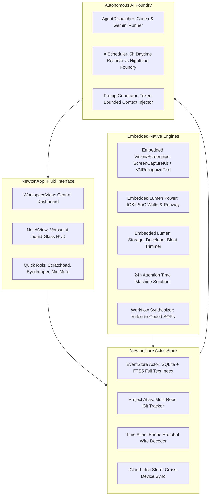

# Newton Architecture — Unified Personal Super-App

The detailed current-state handoff and continuation map is [CONTEXT.md](../CONTEXT.md), with core architectural principles defined in [newton.md](../newton.md).

## Direction: Unified Single-Binary Super-App

Newton directly incorporates the feature suites of **Screenpipe**, **Vorssaint**, and **Lumen** into a single native macOS binary (`Newton.app`). Because Newton is exclusively for Lucas Despot's private personal use, artificial open-source licensing boundaries are eliminated, allowing direct, uninhibited native compilation.

## Concurrency and lifecycle

Swift 6 language mode, no implicit global actor isolation. NewtonWorkspace isolates testable service orchestration from the executable shell. UI and AppKit/IOKit service lifecycles belong to MainActor. EventStore owns a private SQLite connection and serializes reads/writes. Each import is a transaction; unique IDs prevent repeated imports duplicating rows or FTS entries. Stable Lumen identities hash canonical JSON. The UI invalidates stale queries immediately, debounces replacement search, uses keyset pagination and checks request generations before publishing results. A single ingestion worker batches activity, retains failed writes, and drains accepted events through the application delegate before quit.

Startup opens history once per shared workspace model. No background scan timer. Activity uses NSWorkspace notifications and only starts on an explicit toggle. Keep-awake assertions release when disabled; macOS also releases them when the process exits. All features reset to off after relaunch. Requests to Screenpipe use an ephemeral session, timeout, fixed loopback endpoint and disabled redirects; tokens remain in memory and clear when the feature stops.

## Storage and security limits

The app creates a mode-0700 Newton Application Support directory. History uses SQLite WAL and synchronous FULL; there is no encryption layer or automatic retention yet. Logical history deletion updates FTS but does not promise forensic erasure. Imported detail text is potentially sensitive. No automatic access to existing Lumen or Screenpipe data occurs.

The first Screenpipe adapter decodes OCR/audio-like records with stable IDs and valid timestamps; unsupported rows are omitted. Results are bounded to 30 decoded rows, with scalar identities, duplicate filtering and omission counts. The HTTP delegate enforces an 8 MB limit while receiving, rejects redirects/proxies/cookies and responds to cancellation. SQL searches have a cooperative VM budget and SQLite uses a separate busy timeout. Connector compatibility is fixture-tested; a live service has not been established as verified by those tests.

## Milestones

1. **First orbit:** native shell, feature lifecycle, SQLite/FTS, app switches, keep awake, Lumen import, explicit Screenpipe query.
2. **Useful daily workspace:** actual battery/power availability states, project/Git discovery with bounded subprocesses and dirty-state caching, retention/export, better provenance and search filtering.
3. **Utilities:** safe window controls, clipboard history with exclusions/retention, command palette and shortcuts. No unreviewed private API dependency.
4. **Evidence:** decide between independent screen/audio capture and a licensed service integration; permissions, exclusion/pause controls, disk budget and recovery precede always-on recording.
5. **Personal intelligence:** indexed receipts/subscriptions, source-grounded summaries and evidence links. No invented scores or fixed hardware assumptions.
6. **Mobile/agent platform:** authenticated interfaces, pairing and iOS companion after the Mac data contract stabilizes.

Each milestone must include measurable behavior and relevant regression evidence. Current app is not full parity with the three reference products.

## Hardening evidence
Read `docs/audits/2026-10-24-findings.md` for baseline failures, fixes, 58 tests, comparative workload samples, release failure recovery and remaining integration/privacy limits. The scoped audit does not establish absence of every future bug.
