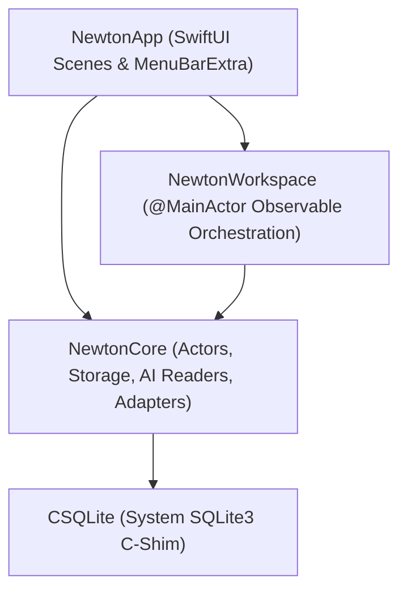

# Newton Architectural Blueprint & AI Context (newton.md)

> **Review status, October 24, 2026:** This blueprint contains design intentions, not verified guarantees. Read the [v0.1.2 review](docs/reviews/2026-10-24-gemini-review.md) and CONTEXT §14. Quota protection is not wired to dispatch, autonomous execution is not implemented by the helper script, generated Python fails syntax checks, and no zero-idle-CPU measurement exists.

> **Identity:** Newton — *"Your tools, your history, one orbit."*  
> **Repository:** `tapchipswipe/newton` (Local authoritative root: `/Users/lucasdespot/newton`)  
> **Platform:** macOS 14+ native, Swift 6 language mode, zero external Swift package dependencies.  
> **Key Architecture Rule:** Actor-isolated persistence, event-driven services as a design goal (idle CPU not measured), and 100% verified live system data (NO mock metrics).

---

## 🏛️ Module Boundaries



1. **`NewtonCore`**:
   - `EventStore.swift`: Private SQLite connection owned by an actor. FTS5 full-text search, schema 2 migrations, deterministic pagination.
   - `CodexQuotaReader.swift`: Offline parser of `~/.codex/sessions` rollout JSONL logs, extracting plan type, 5-hour rolling limits, and reset timestamps.
   - `AIScheduler.swift`: Day/Night rate limit governor (Daytime User Reserve 08:00–22:00 vs Nighttime Autonomous Foundry 22:00–08:00).
   - `PromptGenerator.swift`: Generates character-bounded task briefs (token count and preserved execution instructions not guaranteed) for Codex and Antigravity.
   - `TimeAtlasReader.swift`: Pure Swift binary protobuf decoder (`ProtoWireDecoder`) reading iPhone daily updates from `iCloud~com~timeatlaslabs~Pat/Documents`.
   - `iCloudIdeaStore.swift`: Markdown/Text note discovery in iCloud Drive with SHA-256 deduplication.
   - `ScreenActionRecorder.swift` & `WorkflowSynthesizer.swift`: Coalesces user actions into Standard Operating Procedures (SOPs) and executable Python automation scripts.
   - `ProjectAtlasScanner.swift`: Discovers active local git repositories (`newton`, `work-atlas`, `gods-eye-view`, `macsync`, `fireclock`), branches, and dirty status.
   - `AgentDispatcher.swift`: Executes background AI agent tasks via `/opt/homebrew/bin/codex exec` with live progress tracking and post-run regression tests.

2. **`NewtonWorkspace`**:
   - `WorkspaceModel.swift`: `@MainActor @Observable` coordinator. Owns data store lifecycle, feature toggles, background ingestion, AI quota updates, and agent dispatch.
   - `FeatureServices.swift`: Event-driven system services (`NSWorkspace` notification observer, IOKit power assertions).

3. **`NewtonApp`**:
   - `NewtonApp.swift`: App lifecycle, MenuBarExtra popover with live AI quota, standard AppKit menu commands, and graceful termination drain.
   - `WorkspaceView.swift`: Fluid navigation (Mission Control, Project & Life Atlas, AI Quota & Agents, Work History, Utilities, Connections, Privacy).

---

## ⚡ Concurrency & Safety Contracts

1. **Swift 6 Isolation**: Keep AppKit/UI state strictly `@MainActor`. All database operations run through `any HistoryRepository` actor methods.
2. **Backpressure & Bounded Memory**: Event ingestion queues batch up to 128 items and pause at 4,096 items to prevent runaway memory usage.
3. **Transactional Migrations**: Schema migrations run inside atomic transactions. Reject foreign or unknown schema versions rather than overwriting.
4. **Zero Polling Loops**: Never use periodic timers (`Timer.scheduledTimer`) for background file or system monitoring. Use `NSWorkspace` notifications, `NSMetadataQuery`, or user-triggered events.

---

## 🤖 Dual-AI Collaboration Design Intent (Codex + Antigravity)

1. **Role Division**:
   - **OpenAI Codex**: Targeted component construction (single SwiftUI views, specific parser functions, localized AST transformations). Dispatched via `bin/newton-prompt-gen --exec` or the UI Agent Dispatcher.
   - **Google Antigravity**: Architectural orchestration, multi-file synthesis, repository audits, test suite management (`./test.sh`), and documentation synchronization.
2. **Quota Protection**:
   - **Daytime (08:00 – 22:00)**: Intended to protect user quota; the policy helper has no production execution caller.
   - **Nighttime (22:00 – 08:00)**: Defines a preferred work window; no reset or autonomous-build guarantee is established.
3. **Token Economy**:
   - Never dump entire repositories into prompts. Use local ripgrep and targeted excerpts.
   - On build failures, pass only `tail -15` compiler errors to the AI, not pages of build logs.

---

## 🛠️ Verification & Shipping Pipeline

```sh
./test.sh          # Runs 61 Swift tests + 10 Python delivery checks
./build.sh         # Compiles Newton.app, Newton.zip, and receipt.json
./bin/ship.sh      # Bumps patch version, runs tests, signs, tags, and mirrors release
```
